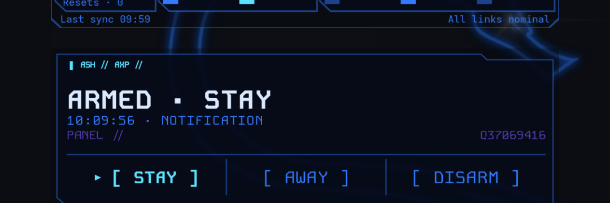
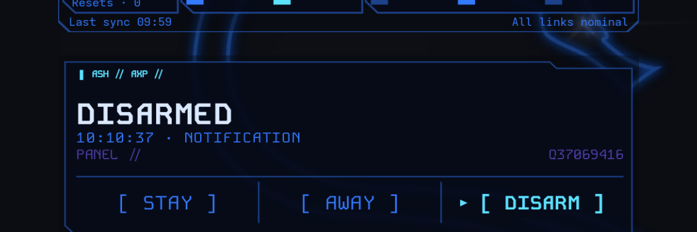

# AlarmShell

Unofficial Hikvision **AX PRO** status and arm/disarm for Android, drawn in the
PhantomShell launcher style.

Native Kotlin app (`dev.wahh.alarmshell`, Android 8+). It talks to the unofficial
Hik-Connect cloud API, keeps the session encrypted with Android Keystore, and shows
the panel in a 4×2 home-screen widget with one-tap **STAY / AWAY / DISARM**.

<p align="center">
  
  
</p>

## What it does

- **State, two sources.** The cloud is queried on every widget refresh
  (`armed` / `disarmed`, per partition) and the official app's own notifications add
  the finer `ARMED · STAY` / `ARMED · AWAY` detail. The widget never invents a state:
  if it cannot confirm one it says `SIN CONFIRMAR`.
- **Three explicit commands.** `CtrlSubSystemArmList` with `armType` `stay`/`away`,
  and `CtrlSubSystemDisarmList`. Nothing else is exposed: no zones, no bypass, no siren.
- **Faults, confirmed like the app.** If the panel reports pending zones, the arm is
  confirmed with `SetSubSystemFaultArmConfirm` (the same thing the official
  "Fault(s) detected. Continue arming?" dialog does).
- **No root, no accessibility service, no dependency on Hikvision's widget.**

## Requirements

- Android 8.0+ (API 26) phone.
- A Hik-Connect account that owns an AX PRO panel.
- The panel must be reachable through Hik-Connect (cloud), not the LAN.

## Build

```sh
export ANDROID_HOME=/path/to/android-sdk
export ANDROID_USER_HOME=$HOME/.android
export GRADLE_USER_HOME=$HOME/.gradle
./gradlew :core:test :app:assembleRelease
```

Release builds are non-debuggable. Signing is local-only: create
`.tools/signing/release.properties` (git-ignored) with `storeFile`,
`storePassword`, `keyAlias` and `keyPassword`; without it `assembleRelease`
produces an unsigned APK.

## Setup

1. Install the APK and open **AlarmShell**.
2. `LOG IN` with your Hik-Connect account. A captcha challenge is shown in-app if the
   cloud asks for one.
3. `LIST DEVICES` and tap `USE <serial>` on the panel.
4. Set **Panel account** (the account name the panel action API expects; it is the
   user shown in the panel's own authorization payload) and `SAVE ACCOUNT`.
5. Long-press the home screen → Widgets → **AlarmShell** (4×2 cells).

The panel serial and account name are intentionally not shipped: they are personal
configuration and stay in the app's private preferences.

## Security notes

- The Hik-Connect session (and its refresh token) grants broad account access. It is
  encrypted at rest with an Android Keystore AES-GCM key; the account password and
  its MD5 are never stored or logged.
- `allowBackup` is disabled and device-transfer rules exclude every app-data domain.
- Release builds are not debuggable, so `run-as` cannot reach the stored session.
- The session is cleared if the record cannot be decrypted.

## Limitations

- **Unofficial.** The API is reverse-engineered and may change without notice; a
  change can break login, state or commands.
- Cloud state is only `armed`/`disarmed`; STAY vs AWAY depends on the app's push
  notifications, so the widget may legitimately show `ARMED` without the mode.
- Arming with a fault is confirmed automatically, exactly like the app's prompt — an
  open zone will not stop the widget from arming.
- `AWAY` is implemented but has not been verified on the reference panel.
- No local/LAN access: the AX PRO panel used here exposes no local ISAPI.

## License

MIT — see [LICENSE](LICENSE).
